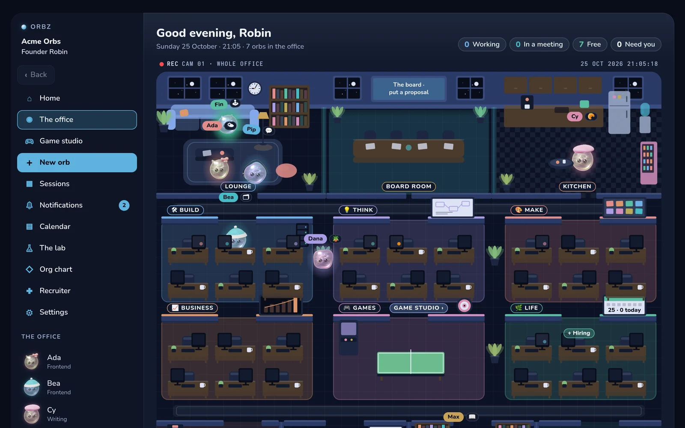
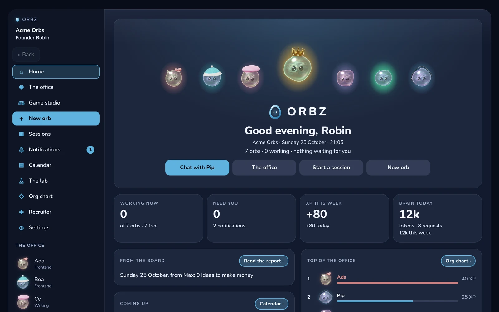
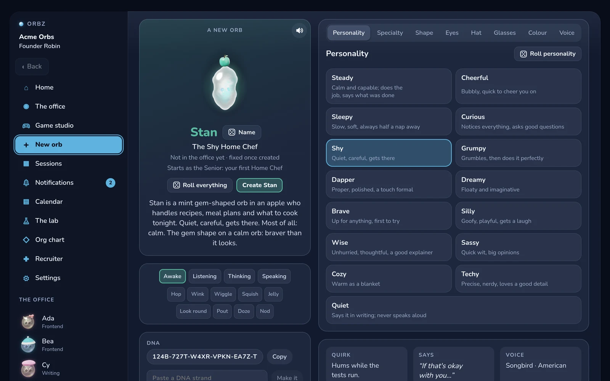
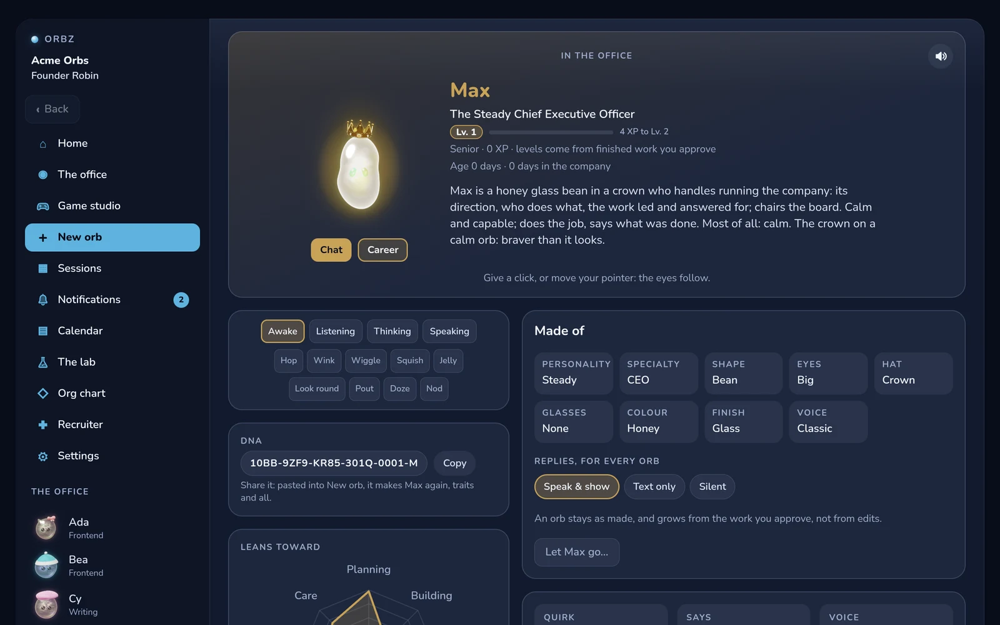

# Orbz

A personal assistant you download and run on your own computer. You talk to a team of
characters, the orbs. Each has a job, a voice, and a computer of its own. They work while
you are away, and they ask before anything that matters.

They also form habits. Each night, work you approved is turned into tested code, so an
orb needs the expensive model a little less every week.

<p align="center">
  
  
</p>
<p align="center">
  
  
</p>

---

## What it does

- **An office of orbs.** You found a small company. A CEO and a personal assistant come
  first. Each department opens with its head. Make an orb in the creator (shape, eyes, hat,
  glasses, colour, voice, job) or hire one through the Recruiter, then watch them work on
  the office floor.
- **Chats and sessions.** Talk to one orb in private, or start a session where several of
  them brainstorm a piece of work, agree on a plan, and build it row by row.
- **A computer each.** Every orb has its own headless Chromium and a sandboxed shell
  (bubblewrap). You can watch its screen live or take it over. Passwords you save are
  typed only on their own site.
- **Habits.** Work climbs a ladder: habit, then the orb's own small model, then the big
  model. The nightly gym finds work done the same way and approved often enough,
  compiles it into a habit, and promotes the habit only when it passes an exam the harness
  runs itself. XP comes from graded work and your approvals, never from what a model says
  about itself.
- **The floor.** Money, passwords, deleting, messaging someone new, changing your calendar,
  and an orb learning a lesson always ask you first. These checks are written in code and
  apply at every rank.
- **Your day.** Your calendars (read only), bills and reminders, mail read and tidied (never
  deleted, never sent), spreadsheets built the way an analyst builds them, lessons drawn on
  an orb's canvas, and voice both ways.
- **Your devices.** The home serves the app to this computer and, over Tailscale, to your
  phone, which can add it to its home screen. There is a terminal client too (`pnpm orbs`).

## The brains

Orbz ships without a model. In the first open, or later in Settings, pick one or more:

- **Continue with ChatGPT**: your ChatGPT plan, through OpenAI's sign-in for apps that run
  locally. No API key.
- **A Gemini API key.**
- **A local model** on an OpenAI-compatible endpoint (llama-server, Ollama).

They are tried in that order. When one is out of quota, the next one answers. Keys and
tokens are kept in the system keychain (`secret-tool` on Linux), never in a file. A Tavily
key turns on web search.

## Running it

Orbz is built and used on Linux. The kit's setup is also checked on a clean Ubuntu 24.04
(`tools/fresh_machine.sh`).

You need Node 24 or newer, pnpm 11, [uv](https://docs.astral.sh/uv/) (it installs the
kit's Python 3.13 itself) and git. An orb's computer uses bubblewrap and Playwright's
Chromium, and your keys go in the keychain through libsecret's `secret-tool`.

```bash
git clone https://github.com/robsevo/orbz.git && cd orbz
pnpm install --frozen-lockfile
pnpm -C packages/home exec playwright-core install chromium
(cd kit && uv run --project . --locked python -m orbs_kit.models)   # voice models, about 510 MB, checked by hash
pnpm -C packages/app build
pnpm start
```

`pnpm start` prints a link that works once, for five minutes. Open it in a browser and the
first open walks you through the rest. The home keeps its data in `~/.orbs` (use
`--data DIR` or `ORBS_HOME` for another) and serves the app on `127.0.0.1:47070`.

To add Orbz to your desktop's app grid, run `tools/desktop/install.sh --repo "$PWD"`. It
opens Orbz in a Chromium-based browser's app window. Then `orbs-open --phone` sets up the
door for your phone (Tailscale and its HTTPS certificate).

## Checking it

```bash
pnpm check            # the gate
pnpm check:controls   # proof the gate can fail
```

`pnpm check` runs the typecheck, the TypeScript tests, the kit's Python suites, the carry
check and copyscan. The TypeScript tests cover the home, the terminal
(driven in a real pty) and the app, which is rendered in Chromium at phone and desk sizes
and checked for overflow, spills, orphans and widows. `pnpm check:controls` plants a type
error, a failing TypeScript test and a failing kit test, one at a time, and each must turn
the gate red for its own reason. It then plants a few hundred real defects in a scratch
copy of the home, the terminal, the app and the kit, and each one must be caught.

The app's render tests use software WebGL, so they are slow. Give them a quiet machine.

## Layout

| Path | What |
|---|---|
| `packages/home` | the home: TypeScript that Node runs directly. The agent loop, the brains, the rules, the gym, and the door (HTTP and SSE) |
| `packages/app` | the app: React and Vite. The orb's shader, its hats and glasses as 3D models, the office floor, every room |
| `packages/terminal` | the `orbs` terminal client (Ink) |
| `kit` | the Python kit, an MCP server the home supervises: voice (Kokoro, Whisper, Smart Turn), lessons, the habit sandbox |
| `kit/ash` | modules carried over from Ash, an earlier assistant, by `tools/adoption/carry.py`, never edited by hand |
| `spike` | the habit spike that decided the project |
| `docs` | the name check, adoption maps, spike results, third-party notes |
| `tools` | the gate's runner, the mutants, copyscan, the desktop launcher |

On screen the product is Orbz. In code, paths, packages and `ORBS_*` variables it is `orbs`.

## License

MIT, see [LICENSE](LICENSE). [NOTICE](NOTICE) lists the third-party parts and the one file
that is not under MIT.
