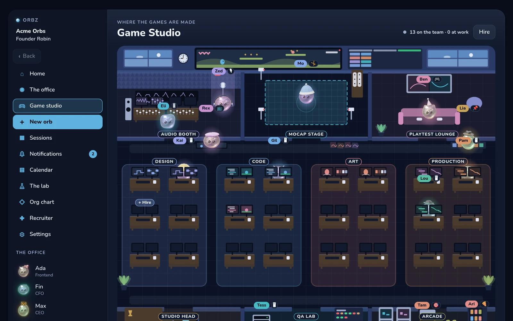
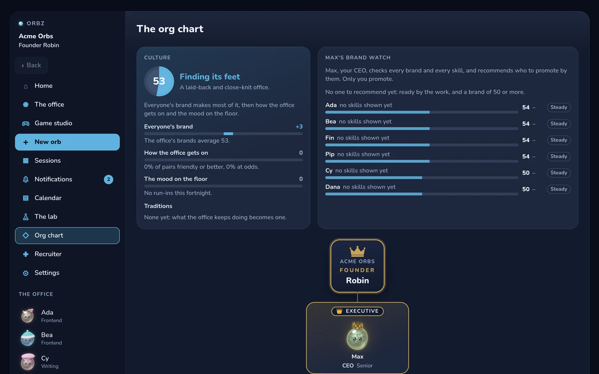

# Orbz

Orbz is a personal AI assistant that runs on your own computer. Instead of one chatbot, you
get a small company of characters called orbs. Each has a job, a voice and a computer of its
own. They keep working while you're away, and they check with you before anything that
matters.

They also get better at their jobs. Every night, the work you approved is turned into tested
code, so each orb leans on the expensive model a little less every week.

<p align="center">
  
  
</p>
<p align="center">
  
  
</p>
<p align="center">
  
  
</p>

---

## What it does

### Your company

- **Found it, then staff it.** You are the Founder. A CEO and a personal assistant join
  first, and each department opens once it has a head. There are more than 80 jobs to fill.
- **Make an orb, or hire one.** The creator sets an orb's shape, eyes, hat, glasses, colour,
  voice and job. Hats, eyes and glasses are real 3D models, and every orb carries a DNA strand
  you can copy to make it again. The Recruiter brings new applicants every day: interview
  one, then hire or pass.
- **A live office floor.** Orbs walk to their desks, work, meet and take breaks. When they
  are free they share coffee, ideas and games, and become friends (or don't). Friendships
  change who works well together.
- **Careers that are earned.** Orbs climb from Junior to Chief on XP from graded work and
  your approvals, never from what a model says about itself. Each orb's brand and the office's
  culture come from that record, and the CEO recommends promotions. Only you promote.
- **A board and a daily report.** A board of orbs votes on proposals, and every morning a
  report brings ideas for making money, sized to the budget you set.

### The game studio

The studio has a floor of its own, through a door in the office's games corner. It has an
audio booth, a mocap stage and a playtest lounge, pods for design, code, art and production,
the studio head's office, a QA lab, and an arcade where a gong rings when work ships.

Its 27 jobs climb twelve career tracks with the titles real studios use: Gameplay Programmer
up to Technical Director, Associate Producer up to Head of Production, Assistant Game
Director up to Chief Creative Officer. Each rung says what that person owns.

### Getting work done

- **Chats and sessions.** Talk to one orb in private, or start a session where several of
  them brainstorm, agree on a plan and build it together on one board. A row is ticked only
  when the home itself runs that row's test.
- **A computer each.** Every orb has its own headless Chromium and a sandboxed shell
  (bubblewrap). Watch its screen live, or take it over. Passwords you save are typed only on
  the site they belong to.
- **Research.** Web search on your own Tavily key, and a reading library that follows sources
  politely (robots.txt, crawl delays) and reads them overnight.
- **Real deliverables.** Excel workbooks with live formulas, checked against LibreOffice's own
  recalculation. Pages, documents and dashboards, shown as what they are. Reverse-engineering
  reports on binaries, apps and network captures. Finished work is copied to a projects
  folder you choose.
- **Lessons and voice.** Ask an orb to teach you something and it draws the lesson on its own
  canvas. Talk to the orbs out loud, with natural turn-taking. Whisper, Kokoro and Smart Turn
  all run on your machine.

### Your day

- Your calendars (read only), bills and reminders, a notification centre, and a home page with
  the day's numbers and charts of tokens and XP.
- Mail read and tidied in one approval. Orbz never deletes mail and never sends it.
- Your own MCP servers as connectors, each tool asking first.

### They learn

- **The nightly gym.** Work climbs a ladder: a habit, then the orb's own small model, then the
  big model. Each night the gym finds work done the same way and approved often enough,
  compiles it into a habit, and promotes the habit only if it passes an exam the harness runs
  itself.
- **School.** An orb you let go can take classes at night, sit exams it never studied from,
  and earn diplomas that count when work is matched to the right orb.

### Safe by design

- **Guardrails in code.** Money, passwords, deleting, messaging someone new, changing your
  calendar and an orb learning a lesson always ask you first, at every rank. These checks are
  code, not a prompt.
- Keys and tokens live in the system keychain. Every device is a listed, revocable session,
  and passkeys are supported.

### Every device

The home serves the app to this computer and, over Tailscale, to your phone, which can add it
to its home screen. There is a terminal client too (`pnpm orbs`).

## The brains

Orbz ships without a model. In the first open, or later in Settings, pick one or more:

- **Continue with ChatGPT**: your ChatGPT plan, through OpenAI's sign-in for apps that run
  locally. No API key.
- **A Gemini API key.**
- **A local model** on an OpenAI-compatible endpoint (llama-server, Ollama).

They are tried in that order. When one runs out of quota, the next one answers and you are told
who is answering. Keys and tokens are kept in the system keychain (`secret-tool` on Linux),
never in a file. A Tavily key turns on web search.

## Running it

Orbz is built and used on Linux. The kit's setup is also checked on a clean Ubuntu 24.04
(`tools/fresh_machine.sh`).

You need Node 24 or newer, pnpm 11, [uv](https://docs.astral.sh/uv/) (it installs the
kit's Python 3.13 itself) and git. An orb's computer uses bubblewrap and Playwright's
Chromium, and your keys go in the keychain through libsecret's `secret-tool`.

```bash
git clone https://github.com/robsevo/orbz.git && cd orbz
pnpm install --frozen-lockfile
pnpm -C packages/home exec playwright-core install chromium
(cd kit && uv run --project . --locked python -m orbs_kit.models)   # voice models, about 510 MB, checked by hash
pnpm -C packages/app build
pnpm start
```

`pnpm start` prints a link that works once, for five minutes. Open it in a browser and the
first open walks you through the rest. The home keeps its data in `~/.orbs` (use
`--data DIR` or `ORBS_HOME` for another) and serves the app on `127.0.0.1:47070`.

To add Orbz to your desktop's app grid, run `tools/desktop/install.sh --repo "$PWD"`. It
opens Orbz in a Chromium-based browser's app window. Then `orbs-open --phone` sets up the
door for your phone (Tailscale and its HTTPS certificate).

## Checking it

```bash
pnpm check            # the gate
pnpm check:controls   # proof the gate can fail
```

`pnpm check` runs the typecheck, the TypeScript tests, the kit's Python suites, the carry
check and copyscan. The TypeScript tests cover the home, the terminal (driven in a real pty)
and the app, which is rendered in Chromium at phone and desk sizes and checked for overflow,
spills, orphans and widows.

`pnpm check:controls` proves the gate can fail. It plants a type error, a failing TypeScript
test and a failing kit test, one at a time, and each must turn the gate red for its own
reason. Then it plants a few hundred real defects in a scratch copy of the home, the terminal,
the app and the kit, and each one must be caught.

The app's render tests use software WebGL, so they are slow. Give them a quiet machine.

## Layout

| Path | What |
|---|---|
| `packages/home` | the home: TypeScript that Node runs directly. The agent loop, the brains, the guardrails, the gym, and the door (HTTP and SSE) |
| `packages/app` | the app: React and Vite. The orb's shader, its hats and glasses as 3D models, the office floor, the game studio, every room |
| `packages/terminal` | the `orbs` terminal client (Ink) |
| `kit` | the Python kit, an MCP server the home supervises: voice (Kokoro, Whisper, Smart Turn), lessons, the habit sandbox |
| `kit/ash` | modules carried over from Ash, an earlier assistant, by `tools/adoption/carry.py`, never edited by hand |
| `spike` | the habit spike that decided the project |
| `docs` | the name check, adoption maps, spike results, third-party notes |
| `tools` | the gate's runner, the mutants, copyscan, the desktop launcher |

On screen the product is Orbz. In code, paths, packages and `ORBS_*` variables it is `orbs`.

## License

MIT, see [LICENSE](LICENSE). [NOTICE](NOTICE) lists the third-party parts and the one file
that is not under MIT.
